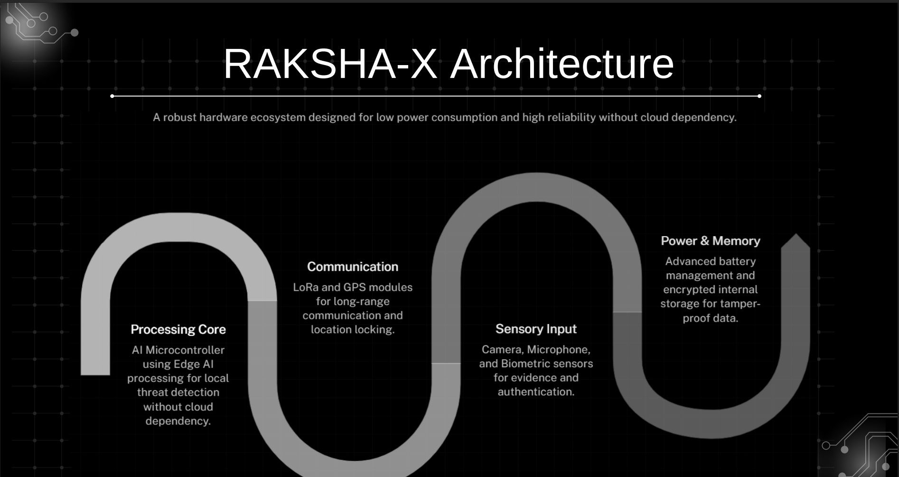
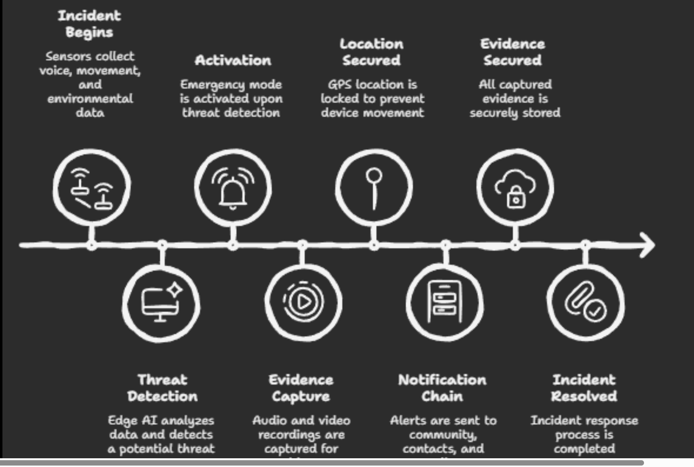
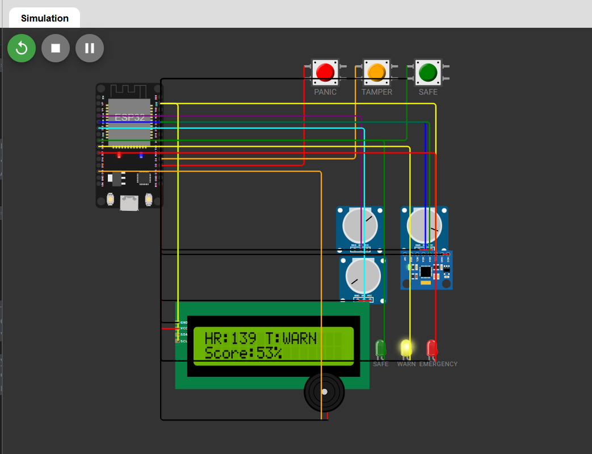

# 🛡️ RAKSHA-X: Autonomous AI-Powered Women Safety Bracelet

> Zero-network protection anywhere. A standalone wearable that detects threats and raises alerts without needing a phone or internet.

**Status:** 🟡 Concept + Hardware Simulation (Wokwi). Physical device not yet built.

**Recognition:** 
   
   - 🏆 MSME 5.0 National Finalist
   - 🥇 1st Prize, Paper Presentation, Mepco Schlenk Engineering College
   - 🥇 1st Prize, Paper Presentation, Kamaraj College of EngineeringMSME 5.0 National Finalist
   - 🥇 3rd Prize, Paper Presentation, Lady Doak College

---

## 🚨 Problem
- Assaults often happen in low-network zones, at night and in isolated areas.
- Most safety apps need a phone, internet and manual activation.
- In panic, a victim may not be able to reach their phone or press a button.

## 💡 Solution
RAKSHA-X is a standalone smart bracelet with AI-based threat detection that:
- Works without a mobile phone or internet
- Is biometrically locked to the user
- Auto-alerts nearby users, trusted contacts and police
- Records tamper-proof evidence

## ✨ Key Features
- AI-based threat detection (voice, movement, environment)
- Voice and video recording
- Offline emergency alert system
- Direct police alert and trusted contacts auto call
- Swarm-based community alert
- Biometric lock and tamper detection
- Offline mode via mesh communication (LoRa)

## 🧠 How Threat Detection Works
| Signal | What is monitored |
|---|---|
| Voice | Screaming, crying, panic tones (Edge AI) |
| Movement | Falls, forceful shaking, running |
| Environment | Darkness, unknown voices |

An alert triggers when threat probability crosses a set threshold.

## 🔔 Multi-level Alert System
1. **Community:** nearby Raksha users alerted
2. **Contacts:** trusted contacts get auto call and live GPS
3. **Authorities:** nearest police station gets location, audio evidence and device ID

## 🏗️ Architecture
- **Processing:** AI microcontroller with Edge AI
- **Communication:** LoRa and GPS modules
- **Sensors:** camera, microphone, biometric sensor
- **Power and Memory:** battery management, encrypted storage
-    

## 🔄 Flow Chart
   

## 🛠️ Tech Stack
IoT Sensors, Edge AI/ML, LoRa, GPS, Encrypted Storage

## 🔌 Hardware Simulation (Wokwi)

ESP32-based simulation of the bracelet logic. Sensors are simulated with potentiometers and buttons. The simulation fuses multiple signals into a threat score and switches between SAFE, WARN and EMERGENCY states.

**▶️ Live simulation:** [Open in Wokwi](https://wokwi.com/projects/456413413513188353)

**Components simulated:** ESP32, MPU6050 (motion), potentiometers (heart rate, GSR, temperature), 16x2 I2C LCD, SAFE/WARN/EMERGENCY LEDs, buzzer, panic/tamper/safe buttons.

**Code:** [`simulation/sketch.ino`](simulation/sketch.ino)

## 💻 Threat Detection Logic (Java)

A Java simulation of the weighted threat scoring and 3-level alert is in [`src/ThreatDetector.java`](src/ThreatDetector.java).

## 📁 Documents
Project presentation and diagrams are in the `docs/` folder.

## 🔮 Future Scope
- Integration with national emergency databases
- Campus and school safety network versions
- Smart-city integration

## 👩‍💻 Developer
- Dharshini D
  
  B.Tech Artificial Intelligence & Data Science, Sethu Institute of Technology
